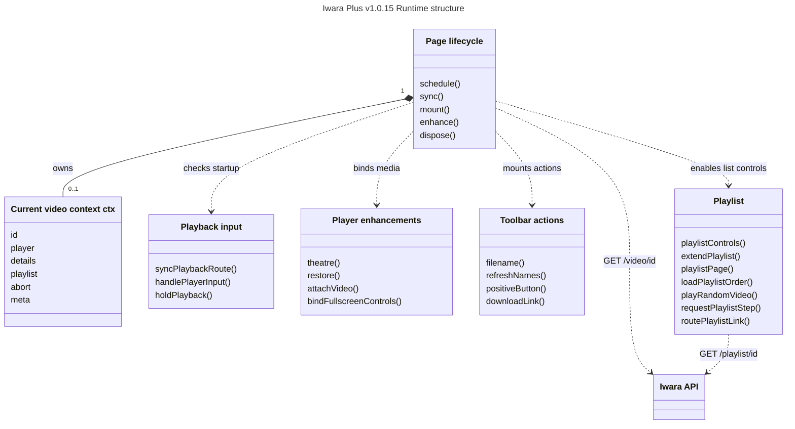
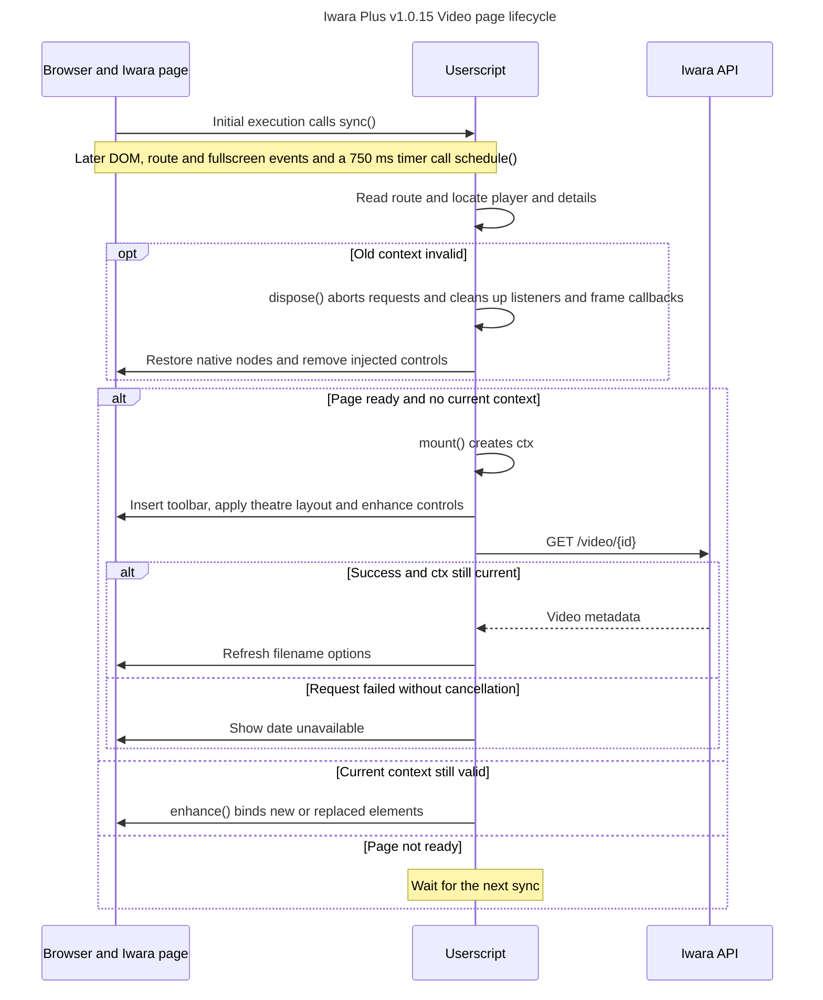
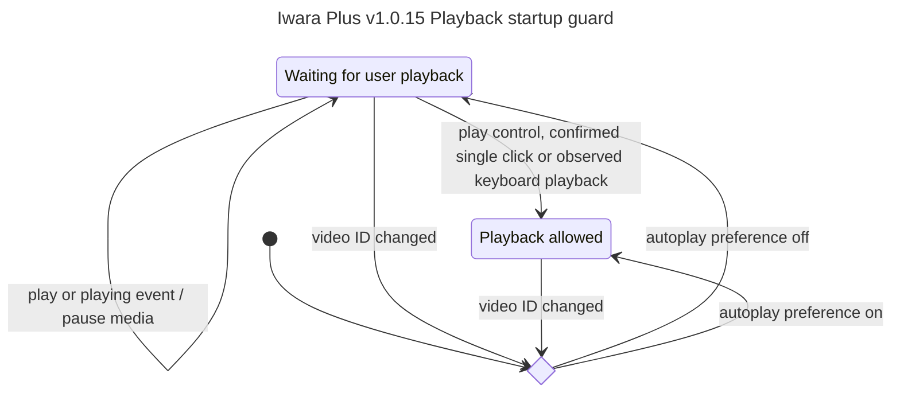
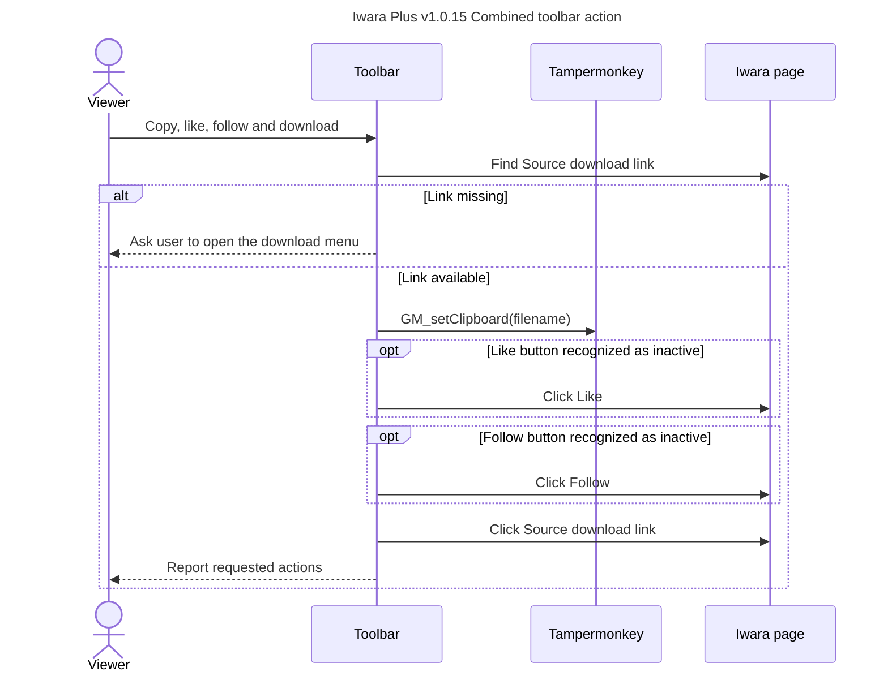
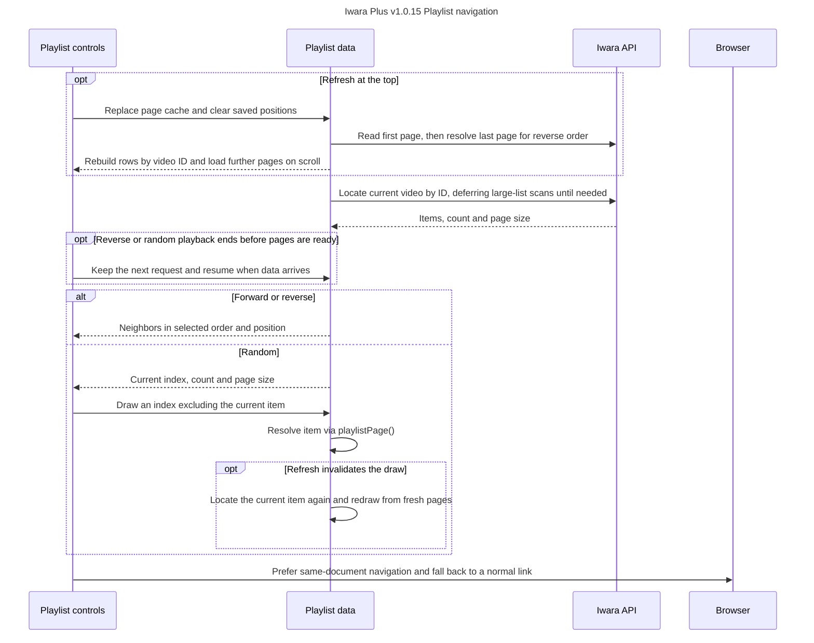
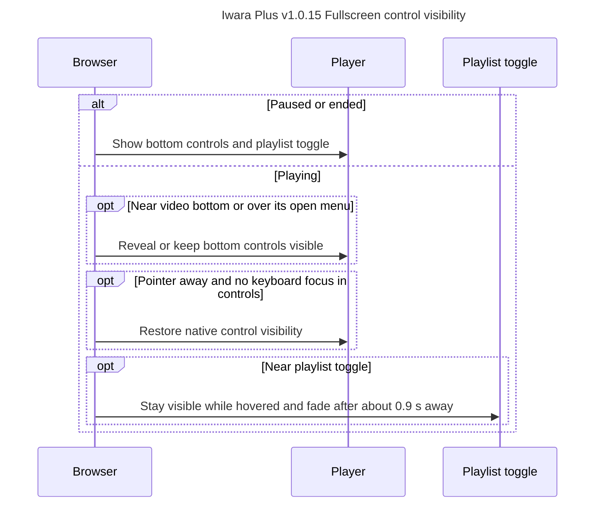

# Iwara Plus runtime UML

English · [简体中文](architecture.zh-CN.md) · [Userscript source](../iwara-plus.user.js)

## Runtime structure

The boxes group functions in the userscript by responsibility. The script holds at most one active video context in `current`. The toolbar, player and playlist functions share that context.

## Video page lifecycle

A change of video, playlist, details node or player container can trigger a remount. Replacing only the video element rebinds its listeners. On `pagehide` the script disposes of the context and stops observing and polling. On `pageshow` it resumes observation, polling and synchronization.

## Playback startup guard

A surface click focuses the player. After 500 ms it toggles playback if the video is still current. A double click cancels the pending toggle and switches fullscreen. With the player focused, I activates picture-in-picture and T toggles theatre mode. The autoplay switch saves the preference used on the next video.

## Combined toolbar action

The toolbar also supports copying a filename, downloading the source and opening the cover individually. Filename format, theatre mode, automatic Source selection and autoplay persist via GM storage. The script localizes controls when the site language changes, preserves native statistics, and estimates frame rate from video frame callbacks.

## Playlist navigation

Playlist pages are cached per video context. Reverse and random modes wait for pending playlist data before advancing at the end of playback. The sidebar extends the visible list by loading pages as needed. In fullscreen the expanded panel can move into the fullscreen element and return to its anchor on exit. Order mode and sidebar collapse state use session storage.

## Fullscreen control visibility

With the sidebar open, the bottom activation area spans only the video width.

On some devices Chrome may show only tooltips during fullscreen playback with graphics acceleration enabled. Current observations suggest a display and graphics driver compatibility issue. Updating the driver or turning off graphics acceleration and restarting Chrome may help.
