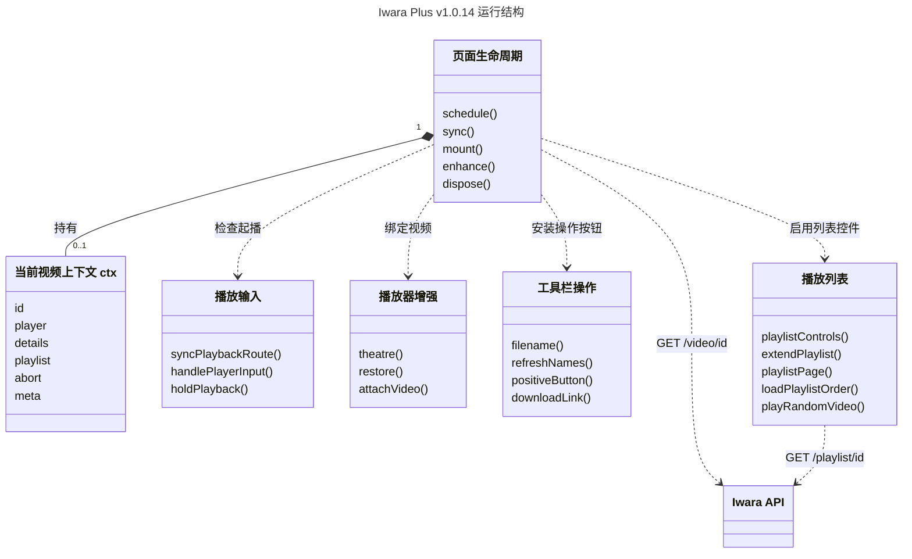
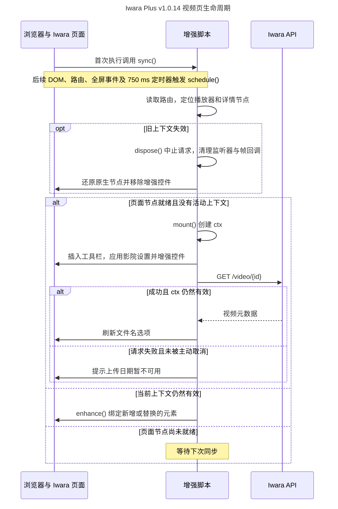
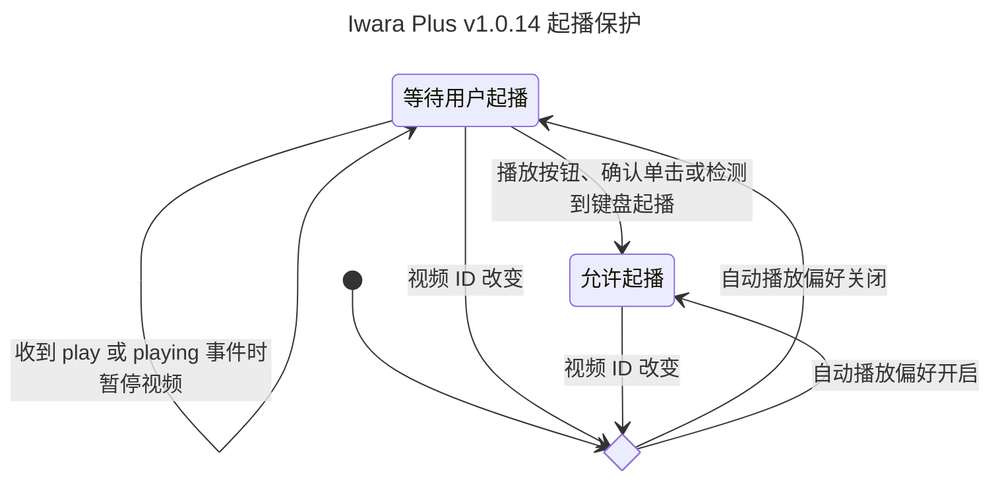
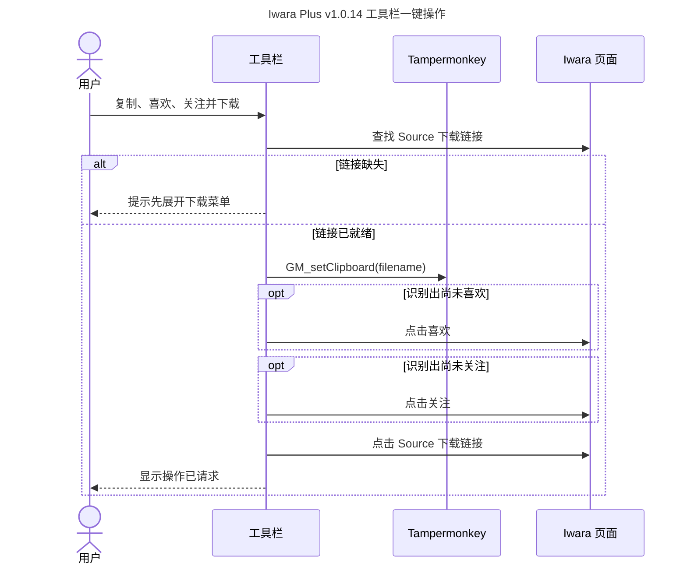
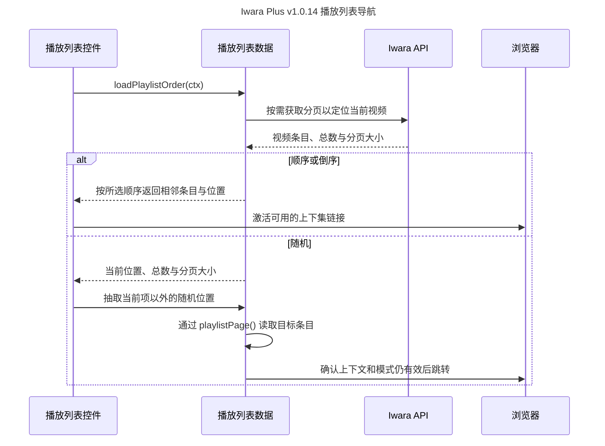

# Iwara Plus 运行时 UML

[English](architecture.md) · 简体中文 · [插件源码](../iwara-plus.user.js)

## 运行结构

方框按职责归纳同一脚本里的函数。脚本通过 `current` 最多持有一个活动视频上下文，工具栏、播放器和播放列表函数共用这个上下文。

## 视频页生命周期

切换视频、播放列表或替换详情节点、播放器容器均可触发重新挂载。仅替换视频元素时，脚本重新绑定视频监听器。`pagehide` 时脚本回收上下文并停止观察与轮询，`pageshow` 时恢复观察、轮询和同步。

## 起播保护

单击画面会将焦点交给播放器，500 毫秒后若仍是当前视频则切换播放。双击会取消待执行的单击操作并切换全屏。播放器获得焦点后，I 切换画中画，T 切换影院模式。自动播放开关保存下次打开视频时使用的偏好。

## 工具栏一键操作

工具栏也支持单独复制文件名、下载原画和打开封面。文件名格式、影院模式、自动选择 Source 和自动播放偏好通过 GM 存储保存。脚本在站点语言改变时更新控件文案，保留原生统计节点，并通过视频帧回调估算帧率。

## 播放列表导航

列表分页缓存在当前视频上下文中。倒序和随机模式在视频结束时触发可用的下一项控件。侧栏按需加载分页以扩展列表。进入全屏时，已展开的面板可移入全屏元素，退出时按锚点归位。播放顺序与侧栏折叠状态保存在会话存储中。

